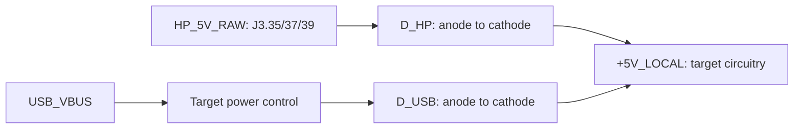

# HP 9835 Unified RAM/ROM Board — Design Decisions

This document records the major design decisions made while developing Revision F of the HP 9835 unified RAM/ROM board. It is intended to preserve the reasoning behind the schematic, HDL, memory map, connector footprint, and programming approach so that later revisions do not accidentally undo an intentional choice.

## 1. Overall objective

The board is intended to combine several existing HP 9835 memory/ROM functions on one card:

- replace one or more option-ROM carriers;
- provide the diagnostic ROM and diagnostic scratch RAM;
- expand system RAM;
- optionally replace the system ROMs if the original ROMs fail;
- permit the NOR flash to be programmed and verified through the ATF1508 JTAG port.

The existing GAL/PAL based RAM, ROM, and diagnostic-board projects supplied in `requirements/original_archives/` and `requirements/extracted/` are the principal behavioural references for the HP bus timing and decoding.

## 2. KiCad schematic is the electrical source of truth

Earlier revisions used a legacy KiCad `.sch` representation and auxiliary connection tables. From Revision F onward, the native KiCad 9 schematic is intended to be the electrical source of truth.

Project location:

`kicad/hp9835_unified_ram_rom_board/`

Project basename:

`hp9835_unified_ram_rom_board`

The design therefore uses modern `.kicad_sch`, `.kicad_sym`, `.kicad_pro`, and custom footprint files. The HDL, CSV files, and documentation must follow the schematic rather than silently defining a different circuit.

## 3. Main programmable logic device

The design uses the 100-pin ATF1508AS rather than larger, less readily available packages.

The pin budget is kept within the 100-pin device by sharing functions where practical rather than adding another CPLD or selecting a hard-to-source package.

The ATF1508 performs:

- HP address capture;
- bank and ROM-segment decoding;
- RAM/ROM chip-select generation;
- memory read/write timing;
- byte-lane control for SRAM;
- HCT245 direction and enable control;
- MIP/ acknowledgement;
- sixteen DIP-switch inputs plus a diagnostic-header input;
- JTAG boundary-scan access to the memory buses.

## 4. HP 9835 address model

The HP 9835 memory interface is not treated as a conventional 16-bit address bus.

The CPU presents:

- a **15-bit word address**;
- a **16-bit data bus**;
- seven bank-select signals.

This reflects the HP 2100-derived architecture. `IDA15` is a data bit and is not part of the word address.

In the HDL the latched address is therefore 15 bits wide:

```vhdl
signal addr_q : unsigned(14 downto 0);
```

The seven bank-select inputs are latched separately.

## 5. Configurable RAM base and special mode (2026-10-04)

The four poles of SW3 encode a binary base 0–15 in 64 KiB increments. Pole 1 is the least significant bit; ON pulls the input low and encodes logical 1. The card supplies its full 512 KiB as eight consecutive even HP blocks: `2*base, 2*(base+1), ..., 2*(base+7)`. Base 1 therefore covers octal blocks 002–020. Base 15 covers octal 036–054. No address wrapping occurs.

Base zero claims block 000 and also block 001 through the original special-mode alias. Existing RAM responders for overlapping blocks must be removed or disabled. Base zero is intended to replace the original base/special RAM function; it is no longer an expansion-only mode that avoids bank 000.

The alias follows the original U13 AND gate on active-low IDA9 and BSC0, as explicitly requested. On block 001 the physical IDA9 input to RAM is forced LOW. Since this CPLD complements the physical bus at capture, logical SRAM A9 is forced HIGH. This aliases address pairs separated by **512 words (1024 bytes)**; the earlier correspondence's byte count is not the implemented rule. Only block 001 aliases; other odd blocks remain available for ROM.

## 6. SRAM choice and physical mapping

The SRAM remains CY62146ELL-45ZSXI, 256K × 16, 44-pin TSOP-II. Its eight physical banks contain 32K words each. For an ordinary RAM cycle, physical bank = HP block/2 minus configured base, and the 15-bit word address is unchanged. Every physical SRAM word is available through the eight ordinary banks.

## 7. Diagnostic RAM mapping

Shorting J4 pins 1–2 enables the diagnostic ROM and scratch RAM independently of the RAM-enable DIP. Diagnostic scratch occupies the top 256 words of octal block 045 and maps to physical SRAM words `0x00000–0x000FF`.

Those words now also belong to the first configured ordinary RAM bank. This is an intentional shared-memory alias: diagnostic writes can overwrite normal RAM. No 512-byte reservation is subtracted from the full 512 KiB. The diagnostic header is intended for a remote dry-contact switch, selected before reset/boot; no hot-switching protocol or debounce logic is provided.

## 8. NOR flash choice

The ROM store is a Macronix MX29F400CBTI-70G-TR, 4 Mbit / 256K × 16, in 48-pin TSOP-I.

The device is operated in x16 mode. `BYTE#` is therefore tied for word operation rather than switched dynamically.

The flash is divided into eight physical 32K-word banks. The CPLD maps the HP ROM blocks/segments into these flash locations according to the ROM layout documented elsewhere in the project.

## 9. 98331B Mass Storage only

The design supports the **98331B Mass Storage option only**.

There is no separate 98331A mode, compatibility generic, or DIP selection. SW1 always enables the complete two-ROM 98331B option as a unit.

The design therefore contains no `MASS_STORAGE_SEGMENT2` option and should not reintroduce a one-segment Mass Storage configuration.

## 10. Configuration switches and remote diagnostics

SW2 remains a 12-pole DIP. Poles 1–9 retain the existing option-ROM enables; pole 10 is reserved for A/B model selection pending verified ROM maps; pole 11 enables RAM; pole 12 enables system-ROM replacement. Pole numbering now follows symbol pad 1 = pole 1 through pad 12 = pole 12, correcting the earlier reversal.

SW3 is a separate four-pole RAM-base DIP. J4 is a two-pin diagnostic header: pin 1 DIAG_N, pin 2 GND, short = enabled. Five added 10k 0805 pull-ups R19–R23 hold the four base inputs and DIAG_N high when open. All existing configuration pull-ups remain.

The A/B-specific system-ROM layout and image differences are explicitly deferred at Mattis's request on 2026-10-04. Existing system-ROM decoding and flash layout remain unchanged. Pole 10 currently has **no effect**; it must not be described as a tested A/B selector. Once the differing ROMs/segments are confirmed, determine whether both non-overlapping variants can be mapped together or require selection.

## 11. DIP-switch pull-ups remain external

The ATF1508AS provides pin-keeper functionality rather than a conventional guaranteed power-up pull-up suitable for configuration switches.

The DIP-switch inputs therefore retain external pull-up resistors, preferably implemented using resistor networks. The intended logic is:

- switch open → HIGH;
- switch closed → LOW.

This provides a deterministic state at power-up.

## 12. Non-inverting 74HCT245 transceivers

The board uses two 74HCT245 non-inverting octal bus transceivers between the HP IDA bus and the memory-side `MEM_D[15:0]` bus.

The earlier idea of using inverting 74HCT640 transceivers was deliberately abandoned because a standard 245 is easier to source and inversion can be handled logically.

The HCT245s provide:

- electrical isolation between the HP bus and the local memory bus;
- direction control for reads and writes;
- isolation of the HP bus during JTAG flash programming.

## 13. Active-low HP bus representation and inversion policy

The HP IDA bus uses an active-low physical representation. Since the 74HCT245s are non-inverting, `MEM_D[15:0]` carries the same physical/complemented representation as HP IDA.

During the address phase the CPLD converts this to the logical address by complementing the sampled bits:

```vhdl
addr_q <= unsigned(not MEM_D(14 downto 0));
```

During normal RAM accesses, no data conversion is required in the CPLD. RAM writes and reads pass through the same non-inverting path, so the complemented physical representation is stored and returned consistently.

For ROM, the flash contents are stored bitwise complemented relative to the logical CPU-visible HP ROM words. The flash-image builder performs this inversion automatically.

## 14. Shared CPLD data pins for address capture and JTAG programming

A key pin-saving decision is that the ATF1508 does not have separate 16-bit HP-IDA and flash-data interfaces.

Its sixteen bidirectional bus pins connect to the memory-side `MEM_D[15:0]` bus.

Those same pins serve three purposes:

1. sample the multiplexed HP address during the address phase;
2. remain high impedance during normal HP data transfers;
3. drive/capture flash data using JTAG `EXTEST` during programming and verification.

This saves sixteen CPLD I/O pins and makes the 100-pin ATF1508 practical.

## 15. JTAG programming strategy

Decision confirmed 2026-11-05: use an onboard **FT232H single-channel USB-to-JTAG bridge** for both CPLD programming and flash access. No separate external JTAG socket/header is required. The FT2232H's second channel is unnecessary for this board.

The FT232H provides one MPSSE interface supporting JTAG; FT232HL in 48-pin LQFP is a suitable assembly-friendly package. See the [FTDI product information](https://ftdichip.com/products/ft232hl/) and [MPSSE command reference, AN_108](https://ftdichip.com/Support/Documents/AppNotes/AN_108_Command_Processor_for_MPSSE_and_MCU_Host_Bus_Emulation_Modes.pdf).

The intended signal mapping is:

| FT232H signal | Direction at FT232H | ATF1508AS TQFP100 connection |
| --- | --- | --- |
| ADBUS0 / TCK | Output | TCK, pin 62 |
| ADBUS1 / TDI | Output | TDI, pin 4 |
| ADBUS2 / TDO | Input | TDO, pin 73 |
| ADBUS3 / TMS | Output | TMS, pin 15 |

This mapping defines the signal endpoints; any buffers and power-off isolation must be included in the schematic design. Keep JTAG enabled in every fitted CPLD image because USB is the intended programming connection.

The same JTAG connection serves two operations:

- CPLD ISP programming, with a device-specific programming sequence such as an SVF file played by an FTDI-capable host tool;
- flash erase/program/read/verify using CPLD boundary scan, without a second USB channel or an additional CPLD serial programming interface.

The MX29F400C is intended to be programmable and readable through the ATF1508 JTAG boundary-scan port.

During flash programming:

- the HCT245s isolate the HP bus;
- boundary scan drives the flash address bus;
- boundary scan drives/captures `MEM_D[15:0]`;
- boundary scan controls flash chip enable and the shared OE/WE signals;
- SRAM remains unselected;
- HP MIP/ remains released.

The programming software must account for the complemented flash-data convention introduced by the non-inverting HCT245 data path. Flash command words must retain their manufacturer-defined values at the flash pins; only ROM payload words follow the complemented-image convention.

USB programming is intended for bench use and must also be electrically safe with the card installed in an **unpowered** HP 9835. USB is normally disconnected while the HP is running; live-machine programming is not a required operating mode. When the HP supply is absent or PROGRAM is selected, hardware must keep the HCT245s disabled and MIP/ released through power-up, CPLD erase/programming and entry to/exit from boundary scan, including before software has established safe output states. This isolation must not depend on a working CPLD image.

Implementation status: this is the accepted programming architecture, not an implemented USB circuit. The current KiCad schematic still contains the earlier J2 JTAG header. Replacing it requires the FT232H support circuit, USB connector and protection, defined startup/suspend states, and power-off-safe JTAG connections. The Schottky supply arrangement below is selected; component sizing, voltage/current margins and the hardware isolation circuit remain to be completed. The flash boundary-scan programmer and hardware verification are also outstanding.

### 15.1 USB bench power and Schottky supply isolation

Decision confirmed 2026-11-05: USB must power the parts needed to program the CPLD and flash on the bench. Use Schottky diodes to isolate the USB and HP supply sources so that USB cannot supply the HP9835 through the card's power contacts, including when the card is installed in an unpowered machine.

The intended target supply connection is:



Both Schottky cathodes connect to `+5V_LOCAL`. `D_HP` blocks USB-to-HP supply current; `D_USB` blocks HP-to-USB supply current, apart from their specified reverse leakage. Ground is common. Raw HP supply contacts and the local target supply must be separate nets; no power symbol, pull-up, test connection or auxiliary supply path may bypass the diodes. This is supply isolation, not galvanic isolation or automatic source priority.

The target domain must include the CPLD, flash and their local pulls/decoupling. Keep the SRAM and HCT245s supplied from that domain as well, with SRAM deselected and the transceivers disabled during programming; leaving these shared-bus devices unpowered would require additional signal isolation. The FT232H can use a separate USB-powered supply branch so it can enumerate before enabling the larger target load. Its JTAG interface must then be safe with either side unpowered, including ordinary HP operation with USB disconnected. Its VCCIO remains 3.3V, not `+5V_LOCAL`.

| Operating condition | Required behavior |
| --- | --- |
| Bench, USB only | FT232H enumerates; USB then powers the programming target within the granted current budget. |
| Installed, HP running, USB absent | HP supplies the card through D_HP; the unpowered USB interface does not disturb JTAG or receive power through signal pins. |
| Installed, HP off, USB connected | USB supplies only the card's programming circuitry; D_HP blocks the power-contact path and HP-facing signals remain inactive. |
| Both supplies present | Neither source is driven by the other. Diode ORing alone does not select a preferred source or make live programming supported. |

Blocking the power-contact path alone is insufficient. Check all HP-facing signals and pull-ups for paths into the unpowered machine, including MIP/, data transceivers and CPLD startup/ISP pin behavior. Qualify HP bus drive using the **raw HP supply**, not the USB-powered local rail; defaults must remain safe before software or JTAG takes control. The existing HCT245 DIR/OE wiring findings must also be resolved against physical pins before relying on transceiver isolation.

The Schottky forward drop must be included in the supply budget for both sources, at worst-case load and temperature. The [ATF1508AS datasheet, Table 1-1](https://ww1.microchip.com/downloads/aemDocuments/documents/MPD/ProductDocuments/DataSheets/ATF1508AS%28L%29-5V-128-Macrocell-CPLD-Data-Sheet-20006682A.pdf) specifies a 4.75V minimum for the commercial device and 4.5V for industrial; the [MX29F400C](https://www.macronix.com/Lists/Datasheet/Attachments/8538/MX29F400C%20T-B%2C%205V%2C%204Mb%2C%20v2.3.pdf), [CY62146ELL](https://www.infineon.com/part/CY62146ELL-45ZSXI) and [74HCT245](https://assets.nexperia.com/documents/data-sheet/74HC_HCT245.pdf) require at least 4.5V. Check CPLD ISP requirements as well. For illustration, 4.75V at a source minus a 0.30V diode drop leaves only 4.45V, which is insufficient. Diode ORing is not regulation and cannot guarantee valid target voltage from every USB source/cable. Diode selection and the supported source range remain subject to this check.

Budget USB current for FT232H, target startup, CPLD ISP and flash erase/program activity. The [FTDI USB hardware guidelines](https://www.ftdichip.com/Documents/AppNotes/AN_146_USB_Hardware_Design_Guidelines_for_FTDI_ICs.pdf) specify the ordinary USB 2.0 limits of 100mA before enumeration and up to 500mA after configuration. The standard ATF1508AS alone has a specified standby maximum above 100mA, so do not connect the whole target load directly at USB insertion. Use a controlled USB target-power branch, appropriate power descriptors and suspend behavior; an FT232H PWREN#-controlled load switch is a candidate. Source blocking remains provided by the Schottky diodes. Check inrush, diode current/thermal ratings and reverse leakage, then verify installed-card backfeed with the HP off before treating this arrangement as validated.

## 16. Shared OE# and WE# signals

Flash and SRAM do not need separate output-enable and write-enable CPLD pins.

The memories share:

- `MEM_OE#`
- `MEM_WE#`

Device selection is performed with separate chip enables:

- `FLASH_CE#`
- `SRAM_CE#`

An unselected device ignores the shared OE/WE activity. This saves two ATF1508 I/O pins.

The default/idle condition must keep both chip enables inactive and both shared control strobes inactive.

## 17. MIP/ is driven directly as open collector

The external tri-state buffer originally proposed for generating the HP MIP/ acknowledge signal is not required.

The ATF1508 output pin connected to HP MIP is configured as **open collector**. The CPLD therefore either:

- pulls MIP low to assert acknowledge; or
- releases the line.

It must never actively drive MIP high.

The ATF1508 pin keeper must be disabled on this signal so the HP wired acknowledge network and its pull-up determine the released state.

The fitter requirements file records this special pin configuration.

## 18. HP bus timing source

The design follows the timing philosophy of the supplied PAL/GAL boards rather than introducing an unrelated asynchronous controller.

The multiplexed address is captured at the HP STM-related address-latch event. `BYTE`, `BL`, and write state are latched with the address because the existing RAM-card design notes indicate that latching BYTE/BL was important for reliable operation.

HP `PH2` is then used for sequencing/acknowledge timing.

No additional oscillator is presently required. Provision for one is not part of the current Rev-F design unless later timing verification demonstrates a need.

## 19. System-ROM replacement caveat

The system-ROM replacement function only makes electrical sense if the original HP system ROMs are absent, disabled, or otherwise prevented from driving the same bus addresses.

The expansion card cannot resolve bus contention merely by decoding the same addresses.

SW12 enables the replacement decode, but installation instructions must require that the original system-ROM drivers are electrically inactive when this feature is used.

## 20. HP memory-bus connector

The card uses a custom 50-contact PCB edge connector footprint matching the HP memory-card interface.

Working geometry for Revision F:

- 50 contacts total;
- 25 contacts per side;
- 2.54 mm pitch;
- nominal finger size 2.0 mm × 10.0 mm;
- nominal 1.6 mm PCB thickness;
- solder mask removed over the contact fingers;
- gold contact finish required/appropriate for the mating area;
- a board-edge bevel is recommended for insertion.

The supplied female connector drawing is retained in this folder as `fce_xx_sg_e_data_sheet.pdf`.

## 21. Edge-connector numbering and orientation

The adopted numbering convention is:

- even-numbered contacts on the component side / F.Cu;
- odd-numbered contacts on the solder side / B.Cu.

Viewed from the **component side**, with the edge fingers pointing upward:

- component side, left to right: `50, 48, 46, ... 6, 4, 2`;
- solder side at corresponding positions: `49, 47, 45, ... 5, 3, 1`.

Thus pin 2 is at the far right and pin 50 at the far left when viewed in that orientation.

The connector reference photographs supplied during the design discussion are kept in `requirements/reference_photos/`.

## 22. Connector mechanical assumptions still subject to physical verification

The 2.54 mm pitch and 50-contact arrangement are considered sufficiently established for the Rev-F footprint.

The 2.0 mm × 10.0 mm finger dimensions and 1.6 mm PCB thickness are the current mechanical design assumptions. They are intentionally documented so they can be adjusted if measurements from an original HP card show a different insertion length, bevel, board thickness, or finger width.

Do not silently change the edge connector geometry without recording the measurement/source that justified the change.

## 23. Custom symbols and footprints

Revision F uses purpose-built symbols for the main devices rather than generic placeholders:

- ATF1508AS, 100-pin TQFP;
- MX29F400CBTI-70G, 48-pin TSOP-I;
- CY62146ELL-45ZSXI, 44-pin TSOP-II.

The custom HP 9835 edge connector footprint is also part of the project library.

Exact package pin numbers are important because the schematic is now the source of truth and will be used directly to generate the PCB.

## 24. PCB layout policy

No routed PCB is considered authoritative until the schematic has been opened and checked in KiCad 9, ERC issues have been reviewed, and the HP connector pinout/mechanics have been verified to the desired confidence level.

Once the schematic is frozen, a `.kicad_pcb` layout can be generated from it. The PCB should not be used to correct schematic connectivity ad hoc; connectivity changes belong in the schematic first.

## 25. Known unresolved items

The following items should remain visible rather than being guessed:

- any HP edge-connector pins whose function is not established by the supplied reference designs;
- connector contact 36, whose function remains unestablished;
- final fabrication specification for edge-finger gold plating and bevel;
- any timing changes required after testing on a real HP 9835;
- exact JTAG in-system programming interlock if programming while installed in a live machine is desired.

The file `documentation/hp9835_connector_pinmap.csv` records unresolved connector contacts explicitly.

## 26. Design philosophy for later revisions

When changing this board, prefer the following order of authority:

1. verified original HP schematics/service information and the supplied reference boards;
2. the verified KiCad schematic and pin assignments;
3. the ATF1508 VHDL and fitter constraints;
4. supporting CSV maps and build utilities;
5. historical discussion notes.

Where a later discovery contradicts a decision in this file, update both the implementation and this document so the reason for the new decision remains traceable.

## 27. Original CPU connector evidence (2026-10-03)

Source: `original_archives/CornerOfOriginalSchematic/LowerRightCorner_CPU_2026-09-30_1155.pdf` and Paul Berger correspondence supplied by Mattis. The CPU drawing calls the connector P2; the board instance remains J3.

- Contact 42 is STM/; contact 33 is STME/. These are separate buffer outputs carrying the same logical strobe. Use 42 on this memory card; never join 33 and 42. STME/ serves the ROM array and 9835A video interface further along the cable.
- No external STM inverter: CPLD pin 87 receives raw `HP_STM_N`. Capture on its falling edge, and qualify active cycles with LOW. This is equivalent to the earlier rising-edge inverted-ALE convention.
- Original names: contact 32 SOB/ (`HP_SOB_N`, reference name SMC), 34 RAL/ (`HP_RAL_N`), 38 SUMC/ (`HP_SUMC_N`, unused), 40 MIP/ (`HP_MIP_N`, reference name UMC), and 46 phi2 (`HP_PH2`). Keep the reference HIGH read-data qualification on contact 32 and HIGH memory-cycle qualification on contact 34 despite the original overbars.
- MIP/ remains the open-collector CPLD output on pin 35. SUMC/ is a different signal and is not substituted for MIP/.
- Ground: 9, 10, 30, 31, 41, 43, 45, 47, 49. +5 V: 35, 37, 39. +12 V: 27, 29. -12 V: 28. +7 V: 50. Only +5 V and ground power this board; the other rails are separately labelled and unused.
- Odd contacts are solder-side; even contacts are component-side. Pin 36 remains unknown and unconnected.

## 28. Original RAM special-mode clarification

Paul explains that the original card's switches control response when -BSC0 is active and optional IDA9 modification. In special mode the affected addresses alias 512 bytes lower, providing a separate upper base page for the virtual PPU. All 32K words remain available: this is address aliasing, not a reserved or protected physical memory region. The OS manages allocation; hardware supplies no memory protection. Original U5 decode outputs feed byte/bank-specific DRAM RAS generation on page 3.

These original RAM-card SW1/SW2 switches are **not** this project's option DIP poles. The configurable-base implementation in sections 5–7 supersedes the earlier expansion-only policy. It follows the physical gate circuit rather than the ambiguous byte-offset wording in the correspondence.
